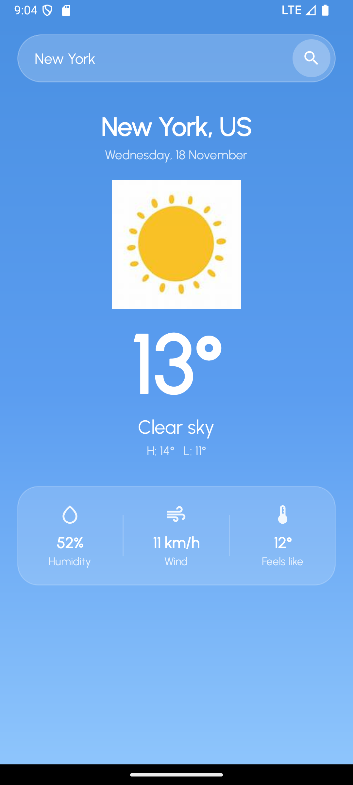
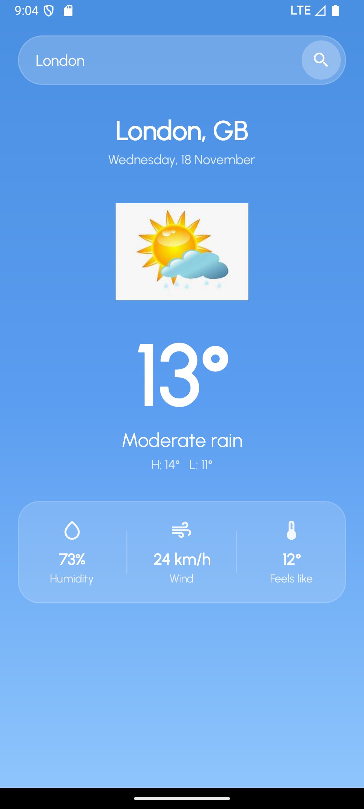
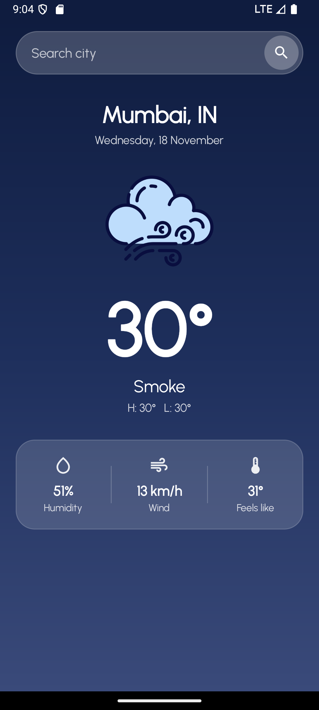

# WeatherApp

An Android app that shows the current weather for any city, using the [OpenWeatherMap](https://openweathermap.org/) API.

## Screenshots

<p align="center">
  
  &nbsp;
  
  &nbsp;
  
</p>

## Features

- Search any city by name
- Current temperature, description, and the day's high and low
- Humidity, wind speed (km/h), and "feels like" temperature
- Background switches between day and night based on the city's local time
- Loading indicator, plus error messages for unknown cities or no connection

## Setup

1. Get a free API key from [openweathermap.org](https://home.openweathermap.org/api_keys).
2. Open `local.properties` in the project root (Android Studio creates it) and add:
   ```properties
   OPENWEATHER_API_KEY=your_key_here
   ```
   This file is gitignored, so your key is never committed.
3. Open the project in Android Studio and run it.

## Built with

- Java
- OkHttp for networking
- Material Components
